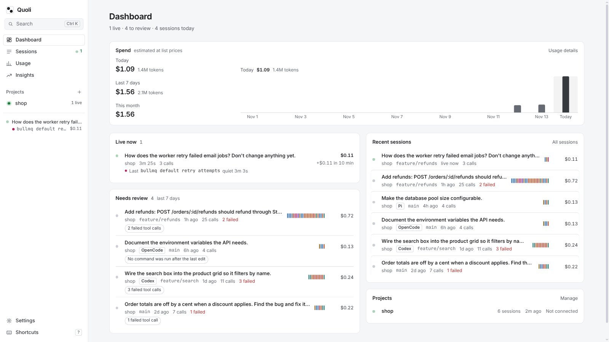
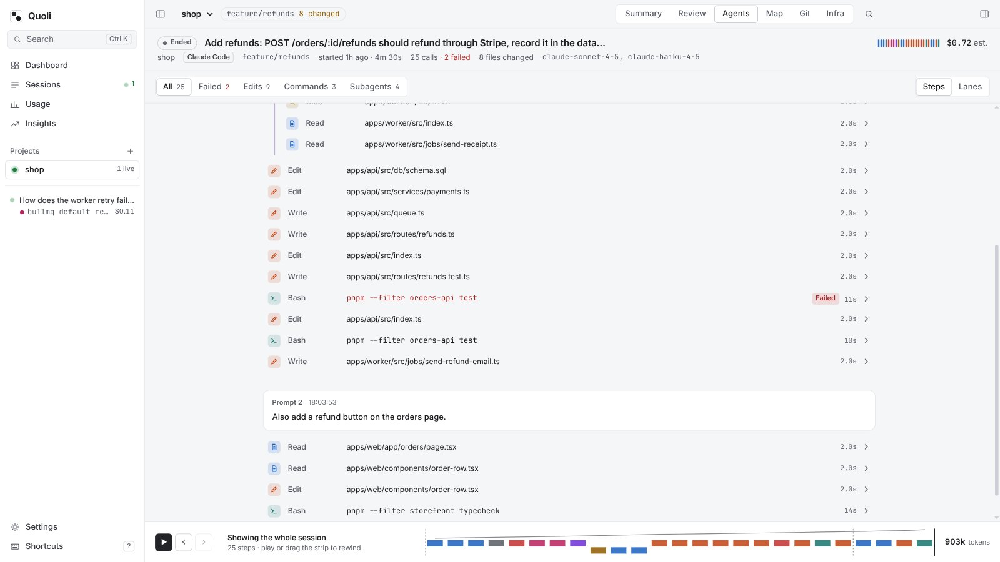
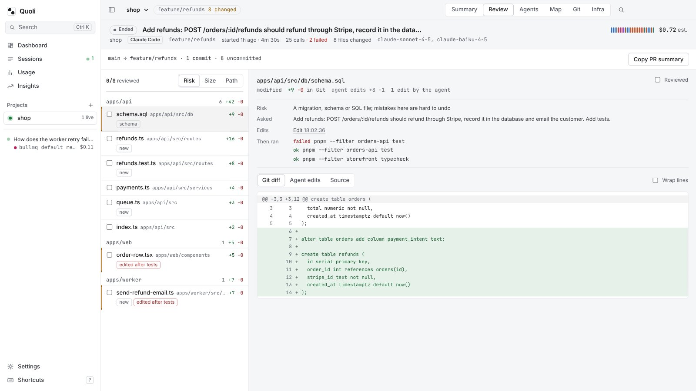
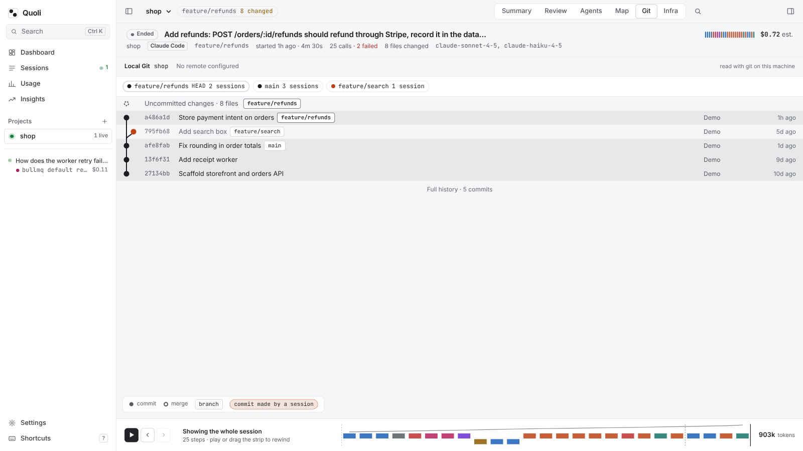
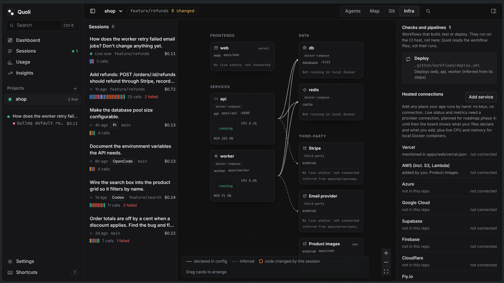
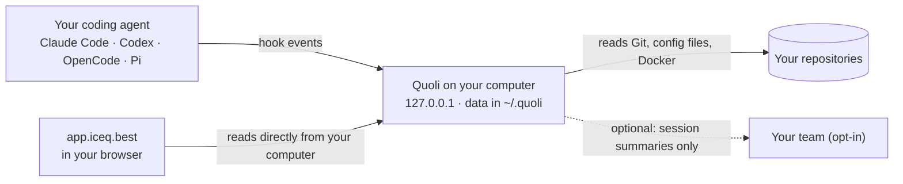

<div align="center">


# Quoli

**See what your coding agents did.**

One visual map of every Claude Code, Codex, OpenCode and Pi session: what it changed, what it ran, what failed, what it cost, and where it happened in your code, Git and infrastructure. Local-first: your prompts and code never leave your computer.

[**Open the app**](https://app.iceq.best) · [Website](https://iceq.best) · [Get started](#get-started) · [How it works](#how-it-works) · [Docs](docs/architecture.md)

[](LICENSE)




</div>

## Why

Coding agents read files, run commands, edit code, spend tokens and commit to branches. That trail ends up scattered across terminal scrollback, Git diffs, cloud consoles and billing pages. Quoli records it as it happens and puts it on one board, so you can answer the questions that matter before you merge:

- **What did the agent actually do?** Every prompt, tool call, command, result, subagent and failure, in order.
- **What did it change, and is it safe?** The files it touched, ranked by risk, with the diff and the tests that ran (or didn't) after each edit.
- **What did it cost?** Spend per session, prompt, model and project, live while it runs.
- **Where does that land?** The branch and commits it produced and the services that run the code.

## Get started

You need [Node.js 22.13 or newer](https://nodejs.org) and one of the supported agents.

```sh
npx https://iceq.best/quoli.tgz
```

Run it **inside the project you work on**. It asks whether to record only this project or every project, sets up your agents' hooks, and starts Quoli in the background, where it starts again at every login. Then open the link it prints: it opens **[app.iceq.best](https://app.iceq.best)** connected to Quoli on your computer (once per browser), and sessions appear live as you use your agent.

| | |
| --- | --- |
| Open the app in another browser | `npx https://iceq.best/quoli.tgz open` |
| Stop Quoli until the next login | `npx https://iceq.best/quoli.tgz stop` |
| Run it in the terminal instead | `npx https://iceq.best/quoli.tgz --foreground` |
| Stop recording and remove it from every agent | `npx https://iceq.best/quoli.tgz setup --remove` |
| Remove Quoli completely, including what it recorded | `npx https://iceq.best/quoli.tgz uninstall` |
| Everything else | `npx https://iceq.best/quoli.tgz --help` |

Your browser may ask once whether app.iceq.best may reach this device: allow it, since that is how the page reads Quoli on your computer. `npx https://iceq.best/quoli.tgz open --local` opens the same app from Quoli itself, without the website.

**Just looking?** Try the synthetic demo from a clone, no agent or API key needed:

```sh
pnpm install && pnpm demo     # then open http://127.0.0.1:4400
```

## One board, six lenses

Every project gets one board. Pick a session and six lenses show the same work from different sides; a replay bar steps through the session call by call and every lens follows along.

| | |
| --- | --- |
|  |  |
| **Agents:** every tool call in order, with full commands, results, subagents and failures, as steps or lanes. | **Review:** the files a session changed, ranked by risk, each with its diff, the prompt that asked for it and what ran afterwards. |
|  |  |
| **Git:** branches and commits, pushed or local-only; commits a session created are marked. | **Infra:** services declared in the repo (Docker Compose, Vercel, Fly, Terraform and more), live CPU and memory for local containers, CI pipelines. |

Plus **Summary** (what was asked, changed, run and spent, and a review checklist) and **Map** (the code a session touched, with what it imports and what imports it).

Across projects: **Dashboard** (spend, live sessions, what needs review), **Sessions** (every session, filterable), **Usage** (spend by model and project, cache savings, budgets), **Insights** (cost and failure trends, possible loops) and optional **alerts** when a session passes a cost or seems stuck.

**Honest by design.** Every fact is marked as recorded, derived or inferred. Unknown values stay empty instead of becoming a made-up zero, and costs are estimates at list prices, not invoices.

## How it works



1. Quoli installs a small hook (or plugin) into each agent. The agent calls it on every prompt, tool call and result; the hook hands the event to Quoli on your computer and never blocks or changes what the agent does.
2. Quoli stores events in a local database and derives sessions, costs, changes and review items from them, reading Git and your config files when needed.
3. The app at app.iceq.best runs in your browser and reads Quoli **straight from your computer**. The website only serves the page; your sessions never pass through it.

## Privacy

- Everything is stored on your computer in `~/.quoli`. Quoli listens only on `127.0.0.1` and answers only browsers paired with it through the link it prints, and only from app.iceq.best or its own page. Other programs and accounts on the computer can't read it, and only your account can open `~/.quoli`.
- Common secrets (API keys, tokens) are redacted before anything is stored. Redaction is best-effort.
- Outbound requests: a version check at iceq.best when Quoli starts (`QUOLI_NO_UPDATE_CHECK=1` turns it off) and a daily download of public model prices from models.dev (Settings → Prices). Nothing else, unless you link an account and turn on Team sync, which shares session summaries (agent, model, repository, branch, counts, estimated spend), never prompts, code, commands or file paths.
- Quoli observes passively: it never blocks, steers or replays an agent.

Found a security problem? Please report it privately: see [SECURITY.md](SECURITY.md).

## Teams and classes

Sign in at [iceq.best/app](https://iceq.best/app/) to create or join a team: a class, a company or a group of friends. Members opt in from Settings → Team sync, and the team sees how it uses coding agents through session summaries only. Setup: [docs/teams.md](docs/teams.md). Several agents or people on one repository: [docs/multiplayer.md](docs/multiplayer.md).

## Develop

Node.js 24 (22.13+ works) and pnpm.

```sh
pnpm install
pnpm demo               # synthetic demo project on http://127.0.0.1:4400
pnpm prototype          # isolated code-journey prototype, synthetic data only
pnpm dev                # the app against your real data, with hot reload
pnpm test               # unit and API tests
pnpm typecheck && pnpm lint
pnpm build              # app + website
```

A larger synthetic example (about 2,400 files, 560+ commits, a 500-call session):

```sh
QUOLI_HOME=/tmp/quoli-demo QUOLI_PORT=4471 pnpm demo -- --large
```

To record your own repositories from a clone, run `pnpm quoli-setup` once (installs Quoli for every agent it finds; `--remove` undoes it) and then `pnpm dev`. To connect a single repository instead, use `pnpm connect /path/to/repo` (add `--agent codex`, `opencode` or `pi`). Where each agent's hook lives, and how the website and package are built and deployed, is in [docs/architecture.md](docs/architecture.md) and [docs/landing.md](docs/landing.md).

## Documentation

- [Product vision and roadmap](docs/vision.md)
- [Architecture, decisions and known limitations](docs/architecture.md)
- [HTTP API](docs/api.md)
- [App design system](DESIGN.md) and [website design](docs/landing-design.md)
- [Website, waitlist and deployment](docs/landing.md)

## Contributing

Issues and pull requests are welcome. Read [CONTRIBUTING.md](CONTRIBUTING.md) to get set up; [AGENTS.md](AGENTS.md) holds the working agreements for coding agents working in this repository.

## License

[MIT](LICENSE). Free to use, change and share.
